  

# 🎯 Awesome Customer Event Tracking

  
  
  
  
  
  

> 🚀 A curated list of leading Customer Event Tracking platforms, Customer Data Platforms (CDP), event collection pipelines, tag management systems, and self-hosted behavioral analytics tools.

📅 **Last updated: October 2026**

Customer Event Tracking forms the foundational telemetry layer for modern growth engineering, product analytics, conversion rate optimization (CRO), marketing attribution, and personalized user journeys. These tools capture user interactions—such as page impressions, clicks, form submissions, video engagement, shopping cart additions, and checkouts—and securely forward event streams to data warehouses, advertising networks, and SaaS destinations.

---

## 📑 Table of Contents

- [📊 Sector Overview & Market Dynamics](#-sector-overview--market-dynamics)
- [☁️ SaaS & Hosted Platforms](#️-saas--hosted-platforms)
- [💻 Open-Source GitHub Projects](#-open-source-github-projects)
- [⚖️ Key Architectural Trade-offs](#️-key-architectural-trade-offs)
- [⭐ Star History](#-star-history)
- [💖 Support & Community](#-support--community)
- [🤝 How to Contribute](#-how-to-contribute)
- [📜 Disclaimer & License](#-disclaimer--license)

---

## 📊 Sector Overview & Market Dynamics

The global Customer Data Platform (CDP) and event-tracking software market is estimated at **$8.2 billion to $10.5 billion in 2025–2026**, expanding at a rapid compound annual growth rate (CAGR) of ~20% to 28% driven by third-party cookie deprecation, privacy regulations (GDPR/CCPA), and AI-driven predictive personalization. The sector exhibits a **moderately concentrated market structure** where mega-cap platform providers (Alphabet/Google, Meta, Shopify, Twilio Segment) command outsized enterprise distribution, while high fragmentation persists across specialized direct-to-consumer (DTC) server-side attribution providers and warehouse-native composable CDP architectures.

---

## ☁️ SaaS & Hosted Platforms

The table below catalogs leading hosted event-tracking platforms, sorted in descending order by parent company scale (market capitalization or latest enterprise valuation).

| Platform | Company Valuation / Scale | Starting Pricing | Free Tier / Trial Limit | Key Features & Best For |
|:---|:---|:---|:---|:---|
| **[Google Tag Manager](https://tagmanager.google.com/)** | **~$2.1 Trillion** *(Alphabet market cap)* | **$0 / month** (Free); GA360 / GTM 360 starts at **~$50,000 / year** | **100% Free forever** (Unlimited tags, triggers, variables, and containers; up to 3 concurrent workspaces) | Industry-standard tag management for client-side tag firing and GA4 / Google Ads routing. On Shopify checkout, requires custom pixel bridges. |
| **[Meta Pixel & Conversions API](https://www.facebook.com/business/tools/meta-pixel)** | **~$1.5 Trillion** *(Meta market cap)* | **$0 / month** (API & web pixel are completely free; optional self-hosted CAPI Gateway costs ~$10–$40/mo in cloud hosting) | **100% Free forever** (Unlimited standard and custom conversion events to Meta Graph API) | Direct ad attribution and dynamic audience remarketing across Instagram and Facebook; supports server-to-server CAPI delivery. |
| **[Shopify Pixels (Web Pixels API)](https://shopify.dev/docs/api/web-pixels-api)** | **~$130 Billion** *(Shopify market cap)* | **$0 / month** (Included natively with all Shopify subscriptions starting at $39/mo) | **Free forever** with Shopify store (No event quotas; runs in strict browser sandbox without DOM access) | Native, privacy-isolated ecommerce event tracking (`product_viewed`, `checkout_completed`) replacing deprecated `checkout.liquid` scripts. |
| **[Segment (Twilio Segment)](https://segment.com/)** | **~$11 Billion** *(Twilio market cap; Segment acquired for $3.2B)* | **$120 / month** (Team Plan) | **Free forever** up to **1,000 Monthly Tracked Users (MTUs)**, 2 sources, 1 warehouse destination, 500k Reverse ETL records/mo | Benchmark Customer Data Platform for turnkey event routing across 450+ SaaS tools, real-time identity graphs, and warehouse syncs. |
| **[Amplitude Analytics](https://amplitude.com/)** | **~$1.5 Billion** *(AMPL NASDAQ market cap)* | **$0 / month** (Plus plan starts free, scales with usage; e.g. ~$225/mo for 5M events/mo) | **Free forever** up to **2,000,000 events/month**, unlimited team seats, core product analytics, and 10k session replays/mo | Deep user journey mapping, behavioural cohorts, conversion funnels, retention analysis, and AI agent telemetry. |
| **[Tealium](https://tealium.com/)** | **~$1.2 Billion** *(Last valuation; Series G)* | **$1,000 / month** *(~$12,000/year billed annually for base Data Cloud Activation)* | **No free tier**; offers a **30-day guided proof-of-concept (POC)** trial through enterprise sales | Enterprise tag management (Tealium iQ) and CDP (EventStream & AudienceStream) with sub-200ms visitor profile enrichment. |
| **[Mixpanel Events](https://mixpanel.com/)** | **~$1.05 Billion** *(Last valuation; Series C)* | **$20 / month** (Growth Plan starting tier) | **Free forever** up to **1,000,000 events/month**, unlimited team seats, 10k session replays/mo, and core funnel reports | Product analytics focused on event stream segmentation, conversion flow analysis, and interactive cohort exploration. |
| **[RudderStack Cloud](https://www.rudderstack.com/)** | **~$300 Million** *(Last valuation; Series B)* | **$265 / month** (Growth Plan, 1M events/mo) | **Free forever** up to **250,000 events/month**, 16+ SDKs, 200+ destinations, and up to 5 event transformations | Developer-centric CDP that turns your data warehouse (Snowflake, BigQuery, Databricks, Redshift) into a real-time event hub. |
| **[Elevar](https://www.getelevar.com/)** | **~$100 Million+** *(Acquired by Buxton / Audiense)* | **$225 / month** (Base paid tier for low order volume) | **15-day free trial** with access to server-side GTM tracking, conversion API destinations, and event monitoring | Specialized Shopify server-side tracking, GTM container automation, and conversion deduplication for DTC ecommerce merchants. |
| **[Littledata](https://www.littledata.io/)** | **~$20 Million** *(Estimated valuation; ~$3M ARR)* | **$0.35 / order** (Flex Plan) or **$199 / month** (Scale Plan up to 1,500 orders/mo) | **30-day free trial** capped at up to 500 tracked orders during the trial evaluation period | Server-side tracking app for Shopify and BigCommerce stores, routing high-fidelity transaction data directly to GA4 and Segment. |

---

## 💻 Open-Source GitHub Projects

The table below highlights open-source customer event tracking systems, self-hosted CDPs, and privacy-first product analytics platforms, sorted in descending order by GitHub stargazers.

| Project | GitHub Stars | License | Primary Architecture | Description & Core Focus |
|:---|:---:|:---|:---|:---|
| **[PostHog](https://github.com/PostHog/posthog)** |  | MIT / PostHog EE | ClickHouse + Python + React | All-in-one product analytics suite providing autocapture & custom event pipelines, session replay, feature flags, A/B experimentation, and data warehouse exports. |
| **[Umami](https://github.com/umami-software/umami)** |  | MIT | Node.js + Prisma (PostgreSQL / MySQL) | Ultra-lightweight, privacy-preserving web analytics platform collecting custom events, outbound link clicks, and page metrics without third-party cookies. |
| **[Plausible Analytics](https://github.com/plausible/analytics)** |  | AGPL-3.0 | Elixir + ClickHouse + PostgreSQL | Lightweight (< 1 KB script) self-hosted analytics tracking custom goal conversions, custom event properties, revenue metrics, and campaigns without storing PII. |
| **[Matomo](https://github.com/matomo-org/matomo)** |  | GPL-3.0 | PHP + MySQL / MariaDB | Comprehensive open-source analytics platform with HTTP Tracking API supporting bulk batch ingestion (up to 500 events), custom dimensions, and ecommerce cart/order tracking. |
| **[OpenReplay](https://github.com/openreplay/openreplay)** |  | Elastic License | Golang + TypeScript + ClickHouse | Self-hosted session recording and customer journey replay engine capturing DOM mutations, network requests, custom events, and performance diagnostics. |
| **[Snowplow](https://github.com/snowplow/snowplow)** |  | Apache-2.0 | Scala + Cloud Data Pipelines | Enterprise behavioral data engine delivering validated, schema-governed event streams directly to Snowflake, Databricks, Redshift, and BigQuery. |
| **[Countly](https://github.com/Countly/countly-server)** |  | AGPL-3.0 / Commercial | Node.js + MongoDB | Real-time product analytics and event tracking platform supporting mobile, web, and IoT SDKs with granular custom crash reporting and funnel tracking. |
| **[Jitsu](https://github.com/jitsucom/jitsu)** |  | MIT | TypeScript + Golang + ClickHouse | Open-source Segment alternative providing drop-in Segment proxy endpoints, per-minute warehouse batch loading, serverless JS transformations, and identity resolution. |
| **[RudderStack Server](https://github.com/rudderlabs/rudder-server)** |  | SSPL | Golang + PostgreSQL | Production-grade open-source CDP data plane collecting, transforming (up to 5 transformations in OSS), and dispatching events to 200+ destinations and data warehouses. |

---

## ⚖️ Key Architectural Trade-offs

When designing customer event tracking infrastructure, teams generally balance three competing paradigms:

1. 🌐 **Client-Side Tagging vs. Server-Side Routing:**
   - *Client-Side (GTM, JS Pixels):* Simple to deploy via UI without engineering releases, but vulnerable to ad blockers, browser privacy restrictions (Safari ITP), and performance drag on page load.
   - *Server-Side (CAPI, Stape, Jitsu, RudderStack):* Highly resilient against ad blockers, enriches event payloads with CRM attributes, and eliminates third-party script vulnerabilities at the cost of infrastructure hosting fees.

2. 📦 **Packaged CDPs vs. Composable CDPs:**
   - *Packaged (Segment, Tealium):* Out-of-the-box UI, managed identity resolution graphs, and instant catalog of 500+ pre-built destinations, but expensive at scale due to MTU pricing tiers.
   - *Composable (Snowplow, Jitsu, RudderStack OSS + Warehouse):* Event data lands directly into your centralized data warehouse (ClickHouse, BigQuery, Snowflake), preventing vendor lock-in and allowing full governance over sensitive PII.

3. 🛒 **Shopify & Ecommerce Sandbox Constraints:**
   - Shopify's deprecation of `checkout.liquid` in favor of the **Web Pixels API** means custom pixels execute in a sandboxed Web Worker isolated from the window DOM. Generic tag managers cannot hook click listeners inside the checkout flow, necessitating either native Web Pixels API implementations or dedicated DTC tracking intermediaries (Elevar, Littledata).

---

## ⭐ Star History

---

## 💖 Support & Community

Thank you so much for exploring this curated guide! If this repository has helped you evaluate customer event tracking tools or architect your data pipeline, please consider supporting the project:

- ⭐ **Star this repository** to help others discover it!
- 🍴 **Fork and share** it with your fellow engineers, marketers, and data architects.
- 💬 Join our discussions on [Discord](https://discord.gg/jc4xtF58Ve) to share your telemetry architectures.
- ☕ **Buy me a coffee / Sponsor**: If you'd like to support ongoing curation and open-source martech resources, please consider sponsoring via the [GitHub Sponsor Dashboard](https://github.com/sponsors/ishandutta2007). Every contribution is deeply appreciated!

---

## 🤝 How to Contribute

We welcome contributions from the data engineering, analytics, and open-source communities:

1. **Fork** this repository.
2. Create a feature branch: `git checkout -b feat/add-event-tool`.
3. Add your entry into the relevant markdown table maintaining existing schema, formatting, and sort order.
4. Provide verifiable references for pricing, valuations, or license details.
5. Submit a **Pull Request** detailing why the tool should be included.

---

## 📜 Disclaimer & License

- **Disclaimer:** This repository is an independently curated community guide. All product names, logos, brands, and registered trademarks belong to their respective owners.
- **License:** Content is licensed under [Creative Commons Attribution 4.0 International (CC BY 4.0)](https://creativecommons.org/licenses/by/4.0/).
